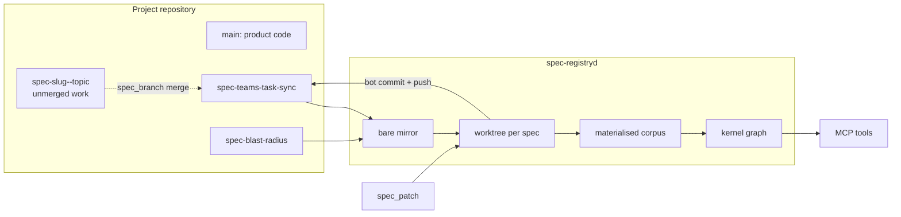

# omp-spec-kit

`omp-spec-kit` gives Oh My Pi (OMP) and Claude Code a bounded view of a repository's specifications: what exists, how requirements connect, and where the graph reports problems.

## Install

One plugin payload (`plugins/omp-spec-kit`) serves both hosts through a single catalog, `.claude-plugin/marketplace.json`. OMP reads it as a fallback; Claude Code reads it directly.

### Oh My Pi (OMP)

Use the project scope so the server reads the project where OMP starts:

```text
omp update
omp plugin marketplace add stgmt/omp-spec-kit
omp plugin install omp-spec-kit@omp-spec-kit --scope project
```

After installing or updating, restart OMP in the target project. A fresh session loads the plugin and its MCP server from that project.

Update an existing project install with:

```text
omp plugin upgrade omp-spec-kit@omp-spec-kit --scope project
```

### Claude Code

Requires Claude Code 2.1.292 or newer. In a Claude Code session:

```text
/plugin marketplace add stgmt/omp-spec-kit
/plugin install omp-spec-kit@omp-spec-kit
/reload-plugins
```

The plugin starts the MCP server with `node` against the project where Claude Code runs, and registers a `PreToolUse` hook that blocks direct reads and writes of `.specs`, so specification access goes through the MCP tools. The hook is a barrier, not a sandbox: the Bash-level checks are regex based and do not catch every way a shell command can reach a file.

## Two surfaces, one product

The plugin install above gives your OMP or Claude Code session the **local kernel**: the 10 MCP tools read the `.specs/` corpus of the project you open the host in — no services required.

The **hosted path** is the spec-registry service (`spec-registryd`): every specification is an orphan `spec-<slug>` branch in its project's own Git repository, with `.spec-kit.json` at the branch root and the corpus under `.specs/<slug>/`. Writes go through the service's MCP endpoint with YouTrack-verified identity, roles, and project scopes. Consumers connect with a `.mcp.json` that carries the `Authorization` header only: the project is never a connection-wide header, it is selected per call from the workspace record described below.



A canonical spec branch contains only `.spec-kit.json` and `.specs/<slug>/**`; work branches (`spec-<slug>--<topic>`) are never indexed or projected and are merged directly by `spec_branch merge`. There is no shared default repository: an unbound project refuses spec operations with `REPO_BINDING_REQUIRED`.

### Project selection per session

A session's project comes from the repository it is actually in, never from a global variable, a request header or a value cached at install time. Each workspace carries one record:

```json
{ "schema": "omp-spec-kit/project-binding@1", "project": "owner/project" }
```

at `<workspace>/.omp-spec-kit/project.json` (git-ignored). Write it with the installer, which requires an explicit project and has no default:

```sh
node scripts/install-host.mjs --host claude --url http://127.0.0.1:8650/mcp --project owner/project
node scripts/install-host.mjs --host codex  --url http://127.0.0.1:8650/mcp --project owner/project
node scripts/install-host.mjs --host opencode --url http://127.0.0.1:8650/mcp --project owner/project
node scripts/install-host.mjs --host omp --project owner/project
```

Every host reads that record at call time for its own session workspace and attaches the project to each registry spec call; an explicit `project` argument on a call still wins for that call only. Two sessions in different repositories run concurrently on their own projects; moving one session to another workspace changes only its next calls — no restart, no reconnect. A spec call in a workspace with no record is refused with `PROJECT_REQUIRED` (and the preflight/setup warning names `spec_repo {"action":"bind",…}`), while ordinary bash/read/edit calls are untouched.

### Keeping the hosts current

A host that holds a copied plugin keeps answering with the version it was installed at, so an upgraded repository and a stale host look identical from the outside. Two commands close that gap:

```sh
npm run hosts:audit    # read-only, exits 1 on drift
npm run hosts:sync     # repairs through the installers, then audits again
```

The audit prints one row per host: the version it holds, the config file it reads, and whether that entry is usable — present, URL matching, no removed `X-Spec-Project` header, no literal bearer token where an environment reference belongs. It finishes with a real `initialize` against the registry, so a broken credential is reported before a session hits it. OMP is checked as a plugin link (its version follows the repository), Claude through its own plugin list, and Codex and OpenCode through the `.installed.json` stamp their installers write.

A running process keeps the environment it started with. When the token in the audit's environment differs from the persisted one, the report says so and names the restart — no installer can replace another process's environment.

The release version is written once and copied everywhere by:

```sh
npm run version:set 3.3.1   # package.json, both plugin manifests, the marketplace catalog, the code constant, the extension entry
npm run version:check       # runs inside npm run verify
```


## Self-hosted demo stack

A complete working contour — YouTrack (identity + app host), `spec-git` (per-project spec branches served as a local fixture), and `spec-registryd` — ships in [`skills/spec-stack-setup/`](skills/spec-stack-setup/SKILL.md) and comes up with one command:

```sh
node skills/spec-stack-setup/setup.mjs
```

It brings the Docker Compose stack up, completes the YouTrack wizard, wires the service token and registry config, installs the YouTrack app, seeds template specifications through real MCP calls, and prints a ready Spec Board dashboard link (`http://127.0.0.1:8089/dashboard?id=…`, login `admin` / `SpecDemo!2026`). Idempotent — re-running converges.

### YouTrack app

The YouTrack app (`spec-graph-app`) ships as a ZIP asset on each GitHub release. Always take the ZIP from the latest release; never install an older `spec-graph-app-*.zip` that is still lying around locally.

Install into your YouTrack via **Administration → Apps → Add app → Upload ZIP**, or headlessly:

```sh
# Latest app asset from the current release, then upload that exact file.
gh release download --pattern 'spec-graph-app-*.zip'
curl -X POST -H "Authorization: Bearer <admin-token>" \
  -F "file=@spec-graph-app-<app-version>.zip" \
  https://<youtrack>/api/admin/apps/import
```

After install, open **Administration → Integrations → Spec Service** (the app adds no item to the main left navigation and no setup link inside issues) - it walks through repository binding and produces the `.mcp.json` snippet (minted YouTrack token included) to paste into your agent's MCP config. The Spec Board dashboard widget renders the committed specification graph projected into YouTrack issues; the issue view keeps only the read-only Spec Panel.

> **Upgrading from a pre-1.0.27 ZIP:** those packages declared `MAIN_MENU_ITEM`, so `Spec Service` appeared in the main left navigation. A current package declares no main-menu item. If the left navigation still shows it, reinstall the latest ZIP and confirm the app version on **Administration → Apps**; an old package is never silently accepted by `spec-stack-setup` (it fails with `app package is stale`).

## Available today

The local kernel in v3.1.0 is exactly 10 task-oriented MCP tools: 9 bounded read-only tools and one transactional patch tool. The hosted registry adds service-owned operations on top — `spec_registry`, `spec_drift`, `spec_claim`, `spec_release`, `spec_branch`, and `spec_repo` (register or bind a project's specs repository, unbind it, probe a credential, list bindings) — exposed over the same MCP endpoint.

A project must be registered in the registry before it can be read or written; the tool never serves an unregistered working tree as a substitute. Registration is one call, available to an owner verified by the operator's YouTrack: `spec_repo {"action":"register","project":"owner/project","repoUrl":"<git-url>","token":"<fine-grained-pat-with-contents-rw>"}`. It checks the project id against tenants, operator config and existing bindings — so an owned id cannot be taken over — seals the credential, queues the work and answers immediately; the repository clone runs in the background and reports its phase (`queued`, `probing`, `mirroring`, `materialising`, `active`, or `error` with the reason). Poll `spec_repo {"action":"status","project":"owner/project"}` for the phase, the elapsed time and the one next step; the registering login's scope widens as soon as the registration is queued, and nobody else sees the project until the operator adds it to a tenant. Repeating the same registration of the same repository and branch is a no-op, and a queued registration survives a service restart.

An unregistered project never leaves the caller guessing: any refusal names the project, the projects the caller may use, and one `nextAction` that is that exact register call, and `mcp_preflight` answers for it too — `setup.code: "PROJECT_NOT_REGISTERED"`, `credential.repository: "not-bound"`, and the same command as the repair. A project that is configured but unbound gets the bind command instead.

| Need | Tool | Variant |
|---|---|---|
| Catalog & Corpus | `spec_catalog` | `view: "types" | "specs" | "inventory" | "overview" | "status"` |
| Nodes & Search | `spec_entities` | `mode: "get" | "find"` |
| Graph & Traversal | `spec_graph` | `view: "edges" | "trace" | "board"` |
| Documents & Attachments | `spec_documents` | `action: "list" | "read" | "attachment"` |
| Validation & Policy | `spec_inspect` | `check: "scenariosByTags" | "orphans" | "anchor" | "requirementMetadata" | "requirementsPolicy" | "archivalProof" | "validation"` |
| Tasks | `spec_tasks` | filters: `spec`, `statuses`, `phase`, `requirement` |
| Runtime Evidence | `spec_evidence` | `view: "result" | "trace"` |
| Markdown References | `spec_markdown` | headings & links inventory |
| Preflight | `mcp_preflight` | root provenance & admissions |
| Safe Authoring | `spec_patch` | `dryRun` preview or atomic apply with 13 typed intents |
| Branch lifecycle (hosted) | `spec_branch` | `action: "create" | "merge" | "delete"` |

The read and evidence tools share one bounded graph and return structured results with current-project provenance. Evidence is content-addressed and stale when its captured graph or scenario binding no longer matches. `spec_patch` defaults to an in-memory preview; only `dryRun: false` can change a specification through hash-checked atomic transactions.

`spec_evidence` reads cucumber-message NDJSON from fixed locations (`.omp-spec-kit/evidence/last-test-run.ndjson`, `.omp-spec-kit/evidence/bdd-results/run.ndjson`, `tests/fixtures/release-candidate/cucumber-messages.ndjson`) and matches scenarios by their `@id:` tag. With no BDD runner producing that stream, every scenario reports `NOT_RUN` — an expected empty state, not an error.

## Typical use

Ask the agent to:

- list the specifications in this project;
- find a requirement by ID or text;
- show what covers or depends on a requirement;
- trace a requirement through related nodes;
- list parser, graph, or link diagnostics;
- preview or apply a reviewed specification change.

When the answer is in the graph, the agent should use these MCP tools instead of manually scanning `.specs`.

## Release history

- **v0.3.2 — shipped predecessor:** bounded, read-only graph queries.
- **v0.4.1 — shipped:** eight bounded reads plus proposal-first safe authoring; exactly 10 MCP tools.
- **v0.5.4 — shipped predecessor:** additive evidence and navigation surface with 27 direct MCP tools.
- **v0.6.0 — shipped:** single MCP server exposing all 49 tools with fail-closed OMP enforcement.
- **v0.7.0 — shipped:** hardened safe authoring with Windows selectors and execution-payload guard.
- **v0.8.1 — shipped:** consolidated 11-tool surface; superseded tools and release stages removed.
- **v0.10.2 — shipped:** unified validation inspection branch and single `spec_patch` authoring tool with atomic commit.
- **v1.0.0 — shipped:** stable 10-tool MCP surface with bounded reads, transactional authoring, release evidence, and commit-bound attestations.
- **v1.0.2 — shipped:** OMP internal URI guard containment regression fix and deterministic LF release distribution.

- **v1.1.0 — shipped:** direct specification reads, exact document receipts, and root-fingerprint binding.
- **v1.2.0 — shipped:** one-time first-write elicitation protection, read-selector symmetry, and real MCP release proof.
- **v1.4.0 — shipped (1.3.x line):** scenario-authoring design-review gate (`DESIGN_REVIEW_REQUIRED`/`DESIGN_REVIEW_INVALID`), host `tool_call` preflight block, and the `engineering-anti-bike` skill.
- **v2.4.0 — shipped:** merges the 1.3.x line into 2.x — design-review gate and anti-bike skill on the consolidated surface.
- **v2.5.0 — shipped:** onboarding moved off issues onto the app's own Spec Service page; YouTrack-app request signing; managed remote plugin mode.
- **v2.6.0 — tagged, superseded before publication:** Spec Board transitive hover lineage, fullscreen `defaultDimensions`, `spec-stack-setup` skill; the app ZIP build was not byte-reproducible across timezones.
- **v2.6.1 — shipped:** deterministic app ZIP across build timezones, plus all of v2.6.0's content.

The v2.6.1 release is shipped and publicly attested. See docs/validation/release-status-v2.6.1.json for the complete release proof.

## Safety and boundaries

The MCP server reads the active OMP or Claude Code project. It does not use editor LSP as a substitute for the agent-facing MCP API.

Direct untrusted writes to `.specs` are not an alternative API. Use `spec_patch` to preview and apply changes through hash-checked transactions.

The canonical corpus lives on orphan `spec-<slug>` branches of the project repository and is served by the spec registry over MCP; this repository's `main` carries no `.specs/` (see `scripts/check-no-root-specs.mjs`). Code gates run against the frozen fixture under `tests/fixtures/kernel/authoring-real-corpus`; the live corpus is checked through the service with `npm run check:corpus:remote`.

## Project documentation

- [`SECURITY.md`](SECURITY.md) — security and disclosure policy
- [`CONTRIBUTING.md`](CONTRIBUTING.md) — contribution workflow
- [`CHANGELOG.md`](CHANGELOG.md) — release history
- [`ROADMAP.md`](ROADMAP.md) — user-visible delivery sequence
- `docs/validation/release-status-v2.8.1.json` — latest shipped release status and verification record

License: MIT.
