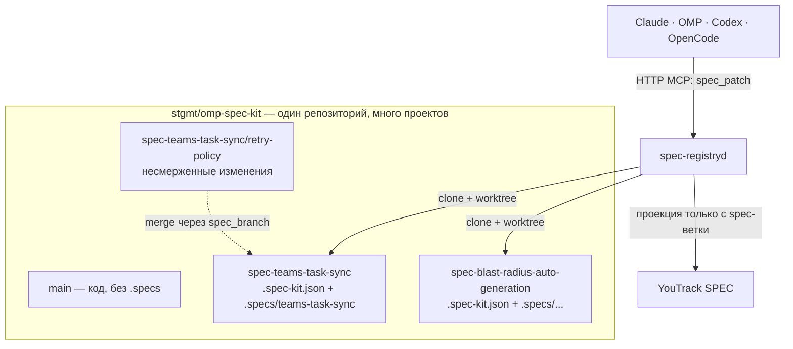

# План: спека = ветка (3.0.0)

Статус: **на согласовании**. Код не меняется до утверждения.
Курировать по Definition of Done; каждый пункт закрывается доказательством (тест, прогон, дифф), а не отметкой.

**Порядок выполнения (решение от 30.10):** P1 → P2 → P3 → P4 → P5 → P6 → P7 → P11 (по мере фаз) → P8 → P9 → **P0 (канонизация спеки)** → **P12 (миграция и запреты)** → P10 (релиз 3.0.0). P0 перенесён в конец: сначала реализация, потом переавторинг канона. Пока P0 не закрыт, спека `spec-registry-service` намеренно расходится с кодом; это отслеживаемый долг, и релиз 3.0.0 заблокирован до P0 + P12.

## 1. Целевая модель



Правила:

1. Ветка спеки: `spec-<slug>`, **orphan** (без родителя, без кода в истории).
2. Сабветка: `spec-<slug>/<topic>` — обычная ветка от ветки спеки.
3. `spec/<slug>` + `spec/<slug>/<topic>` несовместимы в git (ref-файл vs ref-каталог), поэтому дефис.
4. Канон — только `spec-<slug>`; ветки глубины 2 (`spec-<slug>/<topic>`) — рабочие.
5. Один репозиторий может содержать много проектов; проект определяется `.spec-kit.json`.
6. Slug спеки уникален **в пределах репозитория**: имя ветки не должно сталкиваться у двух проектов.
7. На ветке спеки разрешены только `.spec-kit.json` и `.specs/**`; код запрещён.
8. Любая ветка не `spec-*` для реестра не существует; писать в неё сервис отказывается.
9. Нет `stgmt/spec-database`, нет `specs-database`, нет дефолтного репозитория.
10. Токен на репозиторий даёт юзер; на каждый репозиторий свой.
11. Спеки только в git; SQLite — операционная (claims/credentials/ledger/audit).
12. Merge сабветок — прямой, сервисом, под write-lock; PR не используем (ревьюеров нет).

## 2. Зачем сабветки

Сабветка хранит **несмерженные изменения в основную ветку спеки**:

- создаётся от `spec-<slug>` и живёт, пока изменения не влиты;
- не индексируется, не проецируется в YouTrack, не публикуется тегом;
- вливается явным `spec_branch merge`; после merge удаляется (SHA остаётся в аудите);
- конфликт → `MERGE_CONFLICT`, авторазрешения нет;
- содержит только `.spec-kit.json` и `.specs/**`; код в неё попасть не может (проверка пути при merge).

## 3. Метадата `.spec-kit.json`

В корне ветки спеки:

```json
{
  "schema": "omp-spec-kit/spec-binding@1",
  "project": "stgmt/omp-spec-kit",
  "spec": "teams-task-sync",
  "repo": "stgmt/omp-spec-kit",
  "branch": "spec-teams-task-sync",
  "createdAt": "2026-10-30T00:00:00.000Z",
  "owner": "stgmt"
}
```

- `project` — единственный источник привязки спеки к проекту.
- `spec` = slug каталога `.specs/<slug>/` = суффикс ветки.
- `branch` = фактическое имя ветки.
- Реестр читает метадату через `git show <branch>:.spec-kit.json`, без checkout.
- Нет метадаты, расхождение полей, дубль slug в репозитории → `SPEC_BINDING_INVALID`; авторемонта нет.

## 4. Store и секреты

| Таблица | Содержимое |
|---|---|
| `repo_bindings` | project, repoUrl, status, boundBy, boundAt |
| `credentials` | project, repoUrl, tokenEnc (AES-GCM), username |
| `claims` | specKey (`project/spec`), holder, expiresAt |
| `ledger` | specKey, version, digest, commitSha, repoUrl, repoBranch |
| `access_log` | login, role, project, op, spec, result; retention 90 дней |

| Env | Назначение |
|---|---|
| `SPEC_REGISTRY_SECRETS_KEY` | шифрование токенов репозиториев |
| токен репозитория (per repo) | fine-grained PAT, вводит юзер |
| `YOUTRACK_TOKEN` | проверка пользователей/карточек |
| `SPEC_SYNC_MARKER_KEY` | HMAC маркера проекции |
| `SPEC_AGENT_TOKEN` | токен writeback-агента |
| `SPEC_WRITEBACK_TOKEN` | секрет правила YouTrack → listener |
| `SPEC_REGISTRY_CONFIG` / `CLONE` / `STORE` | конфиг, клоны, SQLite |
| `SPEC_REGISTRY_BOT_NAME` / `EMAIL` | identity бота |
| `SPEC_REGISTRY_PROJECTION` | включение проекции |

`SPEC_REGISTRY_GIT_TOKEN` и другие глобальные git-креды удаляются.

## 5. MCP-поверхность

- 11-й инструмент `spec_branch`: `action: create | merge | delete`. Списка веток в нём нет — чтение через `spec_catalog` view `branches` (DRY).
- `spec_patch` остаётся единственным инструментом записи документов.
- Читателям `spec_branch` не виден (фильтр `tools/list`).
- Контракт меняется → полный `@tool-e2e` на 11 инструментов.

## 6. Фазы

### P0. Переавторинг канона через MCP — L

| ID | Задача | Приёмка |
|---|---|---|
| P0-1 | `spec-registry-service`: per-spec orphan branch, metadata, multi-project repo | VALID, покрытие не упало |
| P0-2 | Новые FR/AC/SCEN: discovery веток, metadata, `spec_branch`, merge, no-fallback | каждый AC покрыт |
| P0-3 | `spec-mcp-access-gate`: граница `.specs` на ветке, setup-required | сценарии блокировки |
| P0-4 | `youtrack-visualization`: проекция только с `spec-<slug>` | сабветка не проецируется |
| P0-5 | `spec-mcp-operations`: 11 инструментов, `spec_branch` | tool-contract тесты |
| P0-6 | ADR: «спека = orphan-ветка» | ссылка из README |

### P1. Модель хранения — L

| ID | Задача | Приёмка |
|---|---|---|
| P1-1 | Убрать `specsRepo`/`defaultMount`; binding обязателен | boot падает на unbound |
| P1-2 | Layout: root = worktree ветки, `.specs` в корне | нет `<owner>/<project>` |
| P1-3 | Branch policy: `^spec-[a-z0-9-]+(/[a-z0-9-]+)?$`, защита `main` | unit-тесты |
| P1-4 | Unbound → `REPO_BINDING_REQUIRED` для всех проектов | тест |
| P1-5 | Старый конфиг → `MIGRATION_REQUIRED` с командой, без тихого старта | тест |
| P1-6 | Ledger: `repoBranch` = ветка спеки; retention `access_log` | миграция схемы |

### P2. Discovery и worktrees — L

| ID | Задача | Приёмка |
|---|---|---|
| P2-1 | Список `refs/heads/spec-*`, только глубина 1 | сабветки не в индексе |
| P2-2 | Чтение и валидация `.spec-kit.json` через `git show` | `SPEC_BINDING_INVALID` |
| P2-3 | Lazy worktree на ветку спеки + cleanup | параллельное чтение двух спек |
| P2-4 | Индекс `project → spec → branch` | `/registry` без ошибок |
| P2-5 | Fetch всех веток, не только `main` | новая ветка видна без рестарта |

### P3. `spec_branch` — M

| ID | Задача | Приёмка |
|---|---|---|
| P3-1 | Контракт и схема инструмента | 11 инструментов, читатель не видит |
| P3-2 | `create` orphan `spec-<slug>` + metadata + skeleton | ветка без родителя |
| P3-3 | `create` сабветку от ветки спеки | родитель = спека |
| P3-4 | `merge` под lock, бот-коммит, проверка путей (только `.specs/**` и metadata) | код не проходит |
| P3-5 | `delete` сабветки; ветка спеки защищена | `BRANCH_PROTECTED` |
| P3-6 | `createSpec` создаёт ветку+metadata; `archiveSpec` тегирует и удаляет ветку | нет orphan-мусора |

### P4. Write path / publish / drift — M

| ID | Задача | Приёмка |
|---|---|---|
| P4-1 | `spec_patch` пишет в ветку спеки | коммит в `spec-<slug>` |
| P4-2 | Публикация тега на ветке спеки | тег + ledger |
| P4-3 | Drift по каждой ветке `spec-*` | non-bot commit виден |
| P4-4 | Версионное чтение по тегу | чтение по версии |
| P4-5 | Проекция только с ветки спеки | сабветка не создаёт карточек |

### P5. Setup-required — M

| ID | Задача | Приёмка |
|---|---|---|
| P5-1 | `GET /status` + `mcp_preflight.setup` (per project) | `{required, code, command}` |
| P5-2 | `SETUP_REQUIRED` для spec_* только незатронутого проекта | другие проекты работают |
| P5-3 | Claude: SessionStart + PreToolUse, один раз за сессию | сообщение агенту |
| P5-4 | Codex: SessionStart + PreToolUse | сообщение агенту |
| P5-5 | OpenCode: `session.created` + `tool.execute.before` | сообщение агенту |
| P5-6 | OMP: `tool_call` (+ session_start, если есть) | сообщение агенту |

Хук не настраивает сам: показывает команду и просит юзера выполнить.

### P6. Установщик — M

| ID | Задача | Приёмка |
|---|---|---|
| P6-1 | `projects.json`: проекты + bindings, без `specsRepo` | схема валидируется |
| P6-2 | Ввод токена на репозиторий | без токена — отказ |
| P6-3 | Привязка репозитория проекта | binding active |
| P6-4 | Проверка веток `spec-*` и metadata | setup падает на невалидной |
| P6-5 | Удалить `SPECS_BRANCH` и глобальные git-креды | нулевой grep |

### P7. Тесты — L

| ID | Задача | Приёмка |
|---|---|---|
| P7-1 | Unit: policy, metadata, discovery, duplicate slug | зелёные |
| P7-2 | Service: per-repo mount, worktree, no-fallback, migration error | зелёные |
| P7-3 | E2E: 9 спек → 9 веток, проекция | 15/15 |
| P7-4 | BDD: create/merge/delete, setup-required | зелёные |
| P7-5 | `@tool-e2e` 11 инструментов, архив | полный матрикс |
| P7-6 | Фикстуры/кандидат/BDD | identity зелёный |

### P8. Миграция — L

| ID | Задача | Приёмка |
|---|---|---|
| P8-1 | 9 orphan-веток `spec-<slug>` в `stgmt/omp-spec-kit` | без родителя |
| P8-2 | `.spec-kit.json` + `.specs/<slug>/` в каждой | metadata валидна |
| P8-3 | Binding на репозиторий с токеном юзера | active |
| P8-4 | Ruleset `spec-*`: пуш только бот | проверено |
| P8-5 | Пересборка, рестарт, digest'ы, YouTrack | `/registry` зелёный, 13/8/36/21/29 |
| P8-6 | `stgmt/spec-database` → архив/read-only | не источник истины |

### P9. README-схема — S

| ID | Задача | Приёмка |
|---|---|---|
| P9-1 | Mermaid в README (GitHub рендерит), без SVG и без ссылки на анимацию | рендерится на GitHub |
| P9-2 | Удалить старый `docs/diagrams/spec-write-path.html` | файла нет |
| P9-3 | Runbook, plugin README, SKILL.md | нет старой модели |
| P9-4 | ADR + changelog | ссылки |

### P10. Релиз 3.0.0 — M

| ID | Задача | Приёмка |
|---|---|---|
| P10-1 | Версии 3.0.0 | verify-package |
| P10-2 | Candidate + evidence + attestation | preflight passed |
| P10-3 | GitHub Release + Latest | assets |
| P10-4 | Установка на этот ПК | 4 хоста |
| P10-5 | Финальная матрица | отчёт |

### P11. Выпил рудиментов — M

| ID | Рудимент | Действие | Приёмка |
|---|---|---|---|
| P11-1 | `specsRepo`, `defaultMount`, shortcut `byRepo` | удалить | `rg specsRepo src` = 0 |
| P11-2 | `forSource`, `migratedFrom` | только 3.0.0, `@deprecated`, удалить в 3.1.0 | 3.0.0 миграция работает; 3.1.0 grep = 0 |
| P11-3 | `<owner>/<project>` layout, `projectId.split("/")` | удалить | grep = 0 (кроме валидации id) |
| P11-4 | `SPECS_BRANCH`, `SPEC_REGISTRY_GIT_TOKEN`, `GIT_USER`, `GIT_AUTH_URL` | удалить | grep = 0 |
| P11-5 | `specs-clone` | `clones/<repo>/` + worktrees | grep = 0 |
| P11-6 | `check-spec-corpus.mjs` | удалить | файла нет |
| P11-7 | `stgmt/spec-database` | архив | нет ссылок как на истину |
| P11-8 | `check-specs-repo-protection` под один репо | переписать/удалить | по каждому binding |
| P11-9 | Доки/схема старой модели | переписать | grep = 0 |
| P11-10 | Мёртвые тесты/фикстуры | удалить/переписать | suite зелёный |
| P11-11 | stdio-сервер и `OMP_SPEC_KIT_ROOT` | только тесты/образ | нет «локального режима» в доках |

Refactor:

- `mounts.js` → `bindings` (project → repo) + `specBranches` (spec → branch/worktree), без default.
- `ops/registry.js`, `index.js`: `branch` — поле спеки, не глобальное.
- `branch-policy.js` — одно правило + защита `main`.

### P12. Миграция и проверка запретов (финальный аудит) — M

Выполняется после P0, перед релизом 3.0.0. Это не разработка, а доказательство, что старая модель нигде не осталась.

| ID | Проверка | Приёмка |
|---|---|---|
| P12-1 | Канон соответствует коду: `spec-registry-service` переавторена, VALID | `spec_inspect validation` = VALID |
| P12-2 | Нет центрального репозитория: `stgmt/spec-database` только архив | нет ссылок как на источник истины |
| P12-3 | 9 спек = 9 orphan-веток `spec-*` с валидной metadata | `/registry` показывает 9/9 |
| P12-4 | Slug уникален в репозитории; дубль отклоняется | `SPEC_SLUG_DUPLICATE` |
| P12-5 | На ветках `spec-*` нет кода: только `.spec-kit.json` + `.specs/**` | allowlist-тест + merge-тест |
| P12-6 | Нет `specsRepo`, `SPECS_BRANCH`, `SPEC_REGISTRY_GIT_TOKEN`, `specs-clone`, `<owner>/<project>` | нулевой grep |
| P12-7 | Unbound → `REPO_BINDING_REQUIRED`; spec_* → `SETUP_REQUIRED` по проекту | живые вызовы |
| P12-8 | Ruleset `spec-*`: пуш только бот | GitHub API/аудит |
| P12-9 | 4 хоста: setup-required, блок `.specs`, MCP only | матрица проверок |
| P12-10 | 11 инструментов, полный tool-e2e | зелёный |
| P12-11 | Digest'ы, ledger, YouTrack после миграции | 13/8/36/21/29 |
| P12-12 | Релиз 3.0.0 разрешён только после P12-1…P12-11 | preflight |

## 7. Адверсариальная проверка (что было не так и что исправлено)

| # | Находка | Исправление в плане |
|---|---|---|
| 1 | Два проекта в одном репо с одинаковым slug → коллизия ветки | правило 6: slug уникален в репозитории, `SPEC_SLUG_DUPLICATE` |
| 2 | `spec_branch list` дублировал бы `spec_catalog view branches` | у `spec_branch` только create/merge/delete |
| 3 | `createSpec`/`archiveSpec` не знали про ветки | P3-6: create = ветка+metadata, archive = тег+удаление |
| 4 | В ветку спеки мог попасть код через merge | P3-4: allowlist путей при merge |
| 5 | Worktree на каждую спеку мог разрастись | P2-3: lazy + cleanup + лимит |
| 6 | Старый конфиг мог стартовать «молча» | P1-5: `MIGRATION_REQUIRED` |
| 7 | `SETUP_REQUIRED` мог блокировать настроенные проекты | P5-2: статус per project |
| 8 | SessionStart-хук мог спамить каждую сессию | P5-3: один раз за сессию |
| 9 | 9 отдельных branch protection rules | P8-4: ruleset `spec-*` |
| 10 | `spec_drift` предполагал одну ветку | P4-3: события по каждой |
| 11 | `access_log` рос без границ | P1-6: retention 90 дней |
| 12 | `migratedFrom` мог остаться навсегда | P11-2: удалить в 3.1.0 |
| 13 | README-анимация не рендерится на GitHub | P9-1: Mermaid, без SVG/HTML |
| 14 | Переименование ветки руками ломало бы индекс | правило 3-го раздела: `SPEC_BINDING_INVALID`, без ремонта |

## 8. Definition of Done

- [ ] `spec-registry-service` переавторена через MCP, VALID, покрытие не упало.
- [ ] Нет `specsRepo`, `defaultMount`, `SPECS_BRANCH`, `SPEC_REGISTRY_GIT_TOKEN`, `specs-clone`, `<owner>/<project>` (кроме CHANGELOG/ADR).
- [ ] Unbound → `REPO_BINDING_REQUIRED`; spec_* → `SETUP_REQUIRED` для этого проекта; фолбеков нет.
- [ ] `spec_branch` create/merge/delete работает; merge прямой, аудит, allowlist путей.
- [ ] 9 спек в 9 orphan-ветках `spec-*`; metadata валидна; slug уникален.
- [ ] Проекция только с веток спек; сабветки не проецируются.
- [ ] 4 хоста: setup-required, блокировка `.specs`, MCP only.
- [ ] Unit + service + e2e + BDD + tool-e2e + preflight зелёные.
- [ ] Релиз 3.0.0 с attestation, установлен на ПК.
- [ ] P0 и P12 закрыты: канон = код, миграция и запреты проверены.
- [ ] README содержит Mermaid-схему; старый HTML удалён.

## 10. Прогресс

| Пункт | Статус | Доказательство |
|---|---|---|
| P1-3: модель `spec-<slug>` / `spec-<slug>/<topic>` | **done** | `src/service/spec-binding.js`, 8 тестов |
| P2-2: валидация `.spec-kit.json` | **done** | `validateSpecBinding`, тесты на schema/project/spec/branch/repo |
| P1-1: убрать `specsRepo`/`defaultMount` | next | — |
| P1-2: layout `project-repo` | next | — |
| P2-1/P2-3: discovery + worktree | todo | — |

Следующий шаг: P1-1 — конфиг без `specsRepo`, обязательный binding, `MIGRATION_REQUIRED` для старого конфига; затем P1-2/P2.

## 11. Риски

| Риск | Митигация |
|---|---|
| Git не даёт `spec/<slug>` + `spec/<slug>/<topic>` | `spec-<slug>` + `spec-<slug>/<topic>`, ADR |
| Много worktree | lazy, cleanup, лимит |
| Токены на N репозиториев | AES-GCM, аудит bind, без глобального токена |
| Спека и код в одном репо | ruleset `spec-*`, allowlist путей, drift |
| Миграция меняет digest'ы | новый ledger, перепроекция, архив старого репо |
| 11-й инструмент ломает 10-tool контракт | 3.0.0, tool-e2e матрикс |
